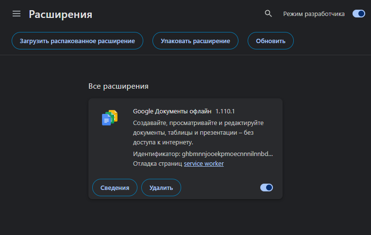
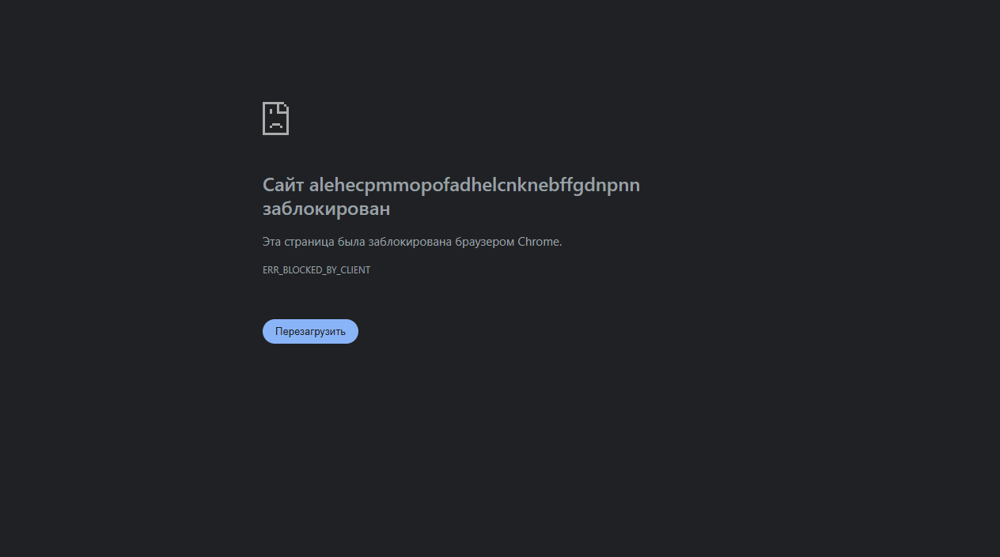
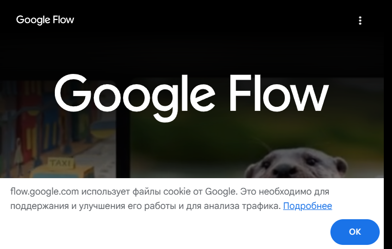

# Инструкция по установке FLOW BRIDGE (Chrome Extension)

Данная инструкция подходит для пользователей **Windows** и **macOS**.

> **Поддерживаемые платформы: Windows и macOS.**  
> **Статус: Beta.**

---

## Требования
* Браузер **Google Chrome** (с поддержкой Manifest V3).
* Доступ к веб-интерфейсу [Google Flow](https://flow.google.com/).

---

## Пошаговая установка

### Шаг 1. Загрузка и распаковка архива
1. Перейдите в раздел [GitHub Releases](https://github.com/jcmir/flow-bridge-downloads/releases) и скачайте официальный релизный архив `FLOW_BRIDGE_Chrome_Extension_v0.1.1.zip`.
2. Распакуйте скачанный zip-архив в постоянную папку на компьютере (например, `~/Documents/flow-bridge` в macOS или `C:\flow-bridge` в Windows).
3. Внутри распакованного каталога находится папка `flow-bridge-extension` с файлами расширения (`manifest.json`, `service_worker.js` и др.).
   > **Важно**: Не перемещайте и не удаляйте папку `flow-bridge-extension` после установки — Google Chrome запускает расширение напрямую из этой директории.

---

### Шаг 2. Включение режима разработчика в Google Chrome
1. Откройте Google Chrome.
2. В адресной строке введите:
   ```text
   chrome://extensions
   ```
   и нажмите **Enter** (или **Return** на Mac).
3. В правом верхнем углу страницы включите тумблер **«Режим разработчика»** (Developer mode). После включения появится панель с кнопкой «Загрузить распакованное расширение».



---

### Шаг 3. Загрузка расширения
1. В левом верхнем углу нажмите кнопку **«Загрузить распакованное расширение»** (Load unpacked).
2. В открывшемся окне выбора файлов найдите распакованную папку и выберите директорию `flow-bridge-extension` (ту самую папку, внутри которой расположен файл `manifest.json`).
3. Нажмите кнопку выбора папки (**«Выбрать папку»** в Windows или **«Выбрать»** в диалоге macOS).
4. В списке расширений появится карточка **FLOW BRIDGE** (версия `0.1.1`). Убедитесь, что переключатель на карточке расширения включён.

---

### Шаг 4. Закрепление и проверка статуса
1. В панели инструментов Chrome нажмите на иконку «пазла» (Расширения) и закрепите значок **FLOW BRIDGE** (⚡) для быстрого доступа.
2. Перейдите на сайт [Google Flow](https://flow.google.com/). При необходимости войдите в свой Google-аккаунт штатным образом непосредственно на сайте Google.
3. Нажмите на иконку FLOW BRIDGE в панели инструментов Chrome:
   - Откроется окно статуса расширения (зелёный индикатор и заголовок `FLOW BRIDGE активен` при нормальной работе).
   - В верхней части окна отображается версия: `v0.1.1`.
4. При активном статусе слой доступности работает, и веб-интерфейс Google Flow готов к использованию.
   > **Примечание**: Если расширение переведено в отключённое состояние (например, на время регламентных работ) или после обновления, уже открытые вкладки `flow.google.com` потребуется обновить вручную (клавиша **F5** в Windows или сочетание **Cmd+R** в macOS).





---

## Обновление или удаление

> **Обратите внимание**: Установленные вручную распакованные расширения **не обновляются автоматически**.

* **Для обновления**:
  1. Скачайте новый релизный архив из раздела [Releases](https://github.com/jcmir/flow-bridge-downloads/releases).
  2. Замените файлы в вашей папке `flow-bridge-extension` новыми версиями из архива.
  3. Откройте `chrome://extensions` и нажмите значок круглой стрелки (**«Обновить»**) на карточке расширения (или перезагрузите страницу клавишей **F5** / **Cmd+R**).
* **Для удаления**: В `chrome://extensions` нажмите кнопку **«Удалить»** на карточке расширения.

---

**Поддержка:** https://t.me/ITHRONIC
